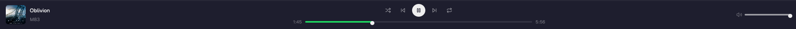
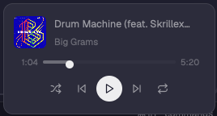
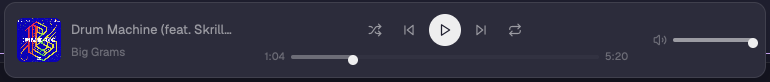
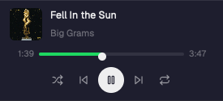

# Herdrify

A floating Spotify player for the [Herdr](https://herdr.dev) desktop app: album cover, title and artist, shuffle, previous, play/pause, next and repeat, a seek bar and a volume bar, docked at the foot of the window.



macOS only. It controls the Spotify desktop app through AppleScript (`osascript`) and downloads cover art with `curl`. macOS may ask once whether Herdr may control Spotify.

## Install

Tell your agent:

```text
Read ~/.config/herdr-app/AGENTS.md, then add this mod: herdr.dev/mods/a88as/herdrify
```

Or by hand:

```sh
cp -R herdrify/mods/herdrify ~/.config/herdr-app/mods/
herdr-app check ~/.config/herdr-app/mods/herdrify
```

Best as a floating player that you drag to any edge (a card on the sides, a bar on the top and bottom). Add this to the root of a personal layout (`layouts/<yours>.json`; Herdr's shipped layouts are read-only, so clone one first with `layout.clone`):

```json
"floating": [ { "id": "herdrify", "content": { "mod": "herdrify" }, "edge": "right", "align": "end" } ]
```

| Side edges | Top and bottom edges |
| --- | --- |
|  |  |

It hides itself while Spotify is closed.

### Docked instead

Otherwise it docks at the bottom of a personal layout by itself. To place it yourself, add this block to a layout of your own (Herdr's shipped layouts take no new blocks; clone one first with `layout.clone`):

```json
{ "id": "herdrify", "type": "block", "size": { "px": 72 }, "content": { "mod": "herdrify" } }
```

It also fits the left sidebar. Below 480 px wide it becomes a stacked card, and in a folded sidebar it is a single play/pause button. Put it in the `sidebar` column above `sidebar-footer`, and pass its own id as `block` so it sizes itself:

```json
{ "id": "herdrify", "type": "block", "size": { "px": 124 }, "content": { "mod": "herdrify", "props": { "block": "herdrify" } } }
```



## Keys

The buttons are also commands: `herdrify.toggle`, `herdrify.next`, `herdrify.previous`, `herdrify.shuffle`, `herdrify.repeat`. For example in `keys.json`:

```json
{ "global": { "ctrl-alt-space": "herdrify.toggle", "ctrl-alt-right": "herdrify.next", "ctrl-alt-left": "herdrify.previous" } }
```

## Build it yourself

[`herdrify/RECIPE.md`](herdrify/RECIPE.md) is the brief an agent can build it from in an empty folder.

Icons are from [Lucide](https://lucide.dev) (ISC). Not affiliated with Spotify.
