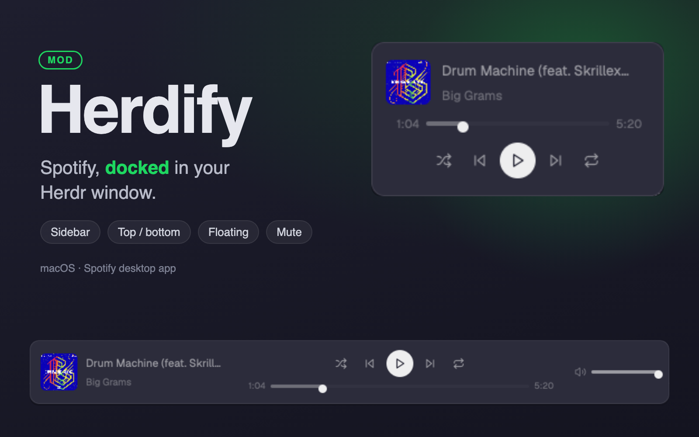
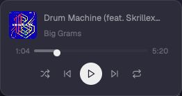
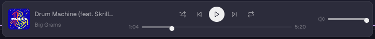
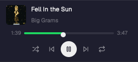

# Herdify

A Spotify now-playing bar along the foot of the Herdr window. On the left is the album cover, the track title and the artist. In the middle are shuffle, previous, play/pause, next and repeat, with a seek bar and the elapsed and total time under them. On the right is a volume bar. It controls the Spotify desktop app on macOS through AppleScript. When Spotify isn't running or nothing is playing, the bar shows one centered line with an "Open Spotify" button. A **move** button on the player docks it into a spot of your choice: the sidebar, the top of the work area or above the status bar. It can also float, and then you drag it to any edge of the window (a card on the left and right edges, a bar on the top and bottom). Docked, it takes real space and adapts to the width it gets: narrower than 480 px it becomes a stacked card (cover and title, seek bar, controls), and narrower than 160 px (a folded sidebar) it is a single play/pause button.



## What you see

### Floating (recommended)

| Left or right edge | Top or bottom edge |
| --- | --- |
|  |  |

Herdr draws the frame (theme background, border, rounded corners, shadow), and the mod draws only its content, with no fill or border of its own. The look follows `placement().vertical`, and while it's being dragged it already shows the look for where it would land.

- **Left/right edges:** the card, 260 px wide, with 12 px by 10 px padding and 8 px between rows. It has the same three rows as the docked card below.
- **Top/bottom edges:** a bar 760 px wide and 64 px tall, with 12 px padding and 14 px gaps. It has a 44 px cover with the track (220 px), the controls (6 px apart) over a seek row (34 px time boxes, 10.5 px text), and the volume icon with an 80 px slider.
- **Idle:** it renders an empty `div()`, so the float disappears while Spotify is closed or nothing is loaded. The one exception is a refused permission: then it shows a single row, "Spotify needs permission", with an **Allow** pill (260 px wide on a side edge, 360 px on the top or bottom).

### Docked

The docked look depends on the block's width: **bar** from 480 px, **card** from 160 px, **rail** below that.

#### Bar (480 px and wider)

One 72 px tall block across the full width of the window. It has the theme `background` fill and a 1 px top border in theme `border`. Contents are vertically centered, with 14 px of padding left and right and 16 px between the three regions. Text is 12 px in `muted` unless stated otherwise. Every color comes from `theme()` except Spotify green, `#1ed760`.

Left to right, while a track is loaded (playing or paused):

1. **Track** (280 px wide, 200 px when the block is narrower than 720 px). A 48 px square cover with a 6 px radius, then 10 px of gap, then two lines with 2 px between them. The title is 13 px medium weight: `foreground` while playing, `muted` while paused. The artist is 11.5 px in `dim`. Both truncate with an ellipsis. With no cover (local files, or a failed download) the square is `raised` with a 20 px Lucide `disc-3` icon in `dim`. Hovering shows `<title> · <artist> · <album>` and "Click to show Spotify". The pointer is a hand.
2. **Player** (fills the middle, at most 640 px, centered, 4 px between its two rows).
   - Controls row, 8 px apart: shuffle, previous (`skip-back`), play/pause, next (`skip-forward`), repeat. Each side button is a 28 px square with a 6 px radius and a 14 px Lucide icon in `muted`. On hover it gets the `hover` fill and the icon turns `foreground`. Shuffle and repeat are `#1ed760` while on, and their tooltips read "Shuffle on/off" and "Repeat on/off". Play/pause is a 32 px circle with a `foreground` fill and a `background`-colored icon (`pause` while playing, `play` while paused, 14 px). On hover it turns `#1ed760` with a black icon. Its tooltip is "Pause" or "Play".
   - Time row, full width of the player, 8 px apart, 11 px text in `dim`: the elapsed time (38 px box, right-aligned), the seek bar, and the total (38 px box). Times are `m:ss` (`5:56`; no hours). The seek bar is a 14 px tall hit area holding a 4 px groove (`raised`, 2 px radius). The fill is `#1ed760` while playing and `dim` while paused, with a 10 px round `foreground` thumb.
3. **Volume** (180 px wide, right-aligned, hidden below 720 px). A mute button: a 24 px square (6 px radius) holding a 14 px speaker icon, `volume-x` at 0, `volume-1` under 50, `volume-2` from 50. The icon is `dim`, or `foreground` while muted; on hover the button gets the `hover` fill and a `foreground` icon. Its tooltip is "Mute (volume <n>)" or "Unmute". Next to it is a 110 px slider in the same style as the seek bar, with a `muted` fill.

#### Card (160 to 479 px, e.g. a 268 px sidebar)



A column with 12 px horizontal and 10 px vertical padding, 8 px between rows, the same `background` fill and top border. 124 px tall with a track.

1. Track: a 40 px cover (6 px radius), then the title (12.5 px medium, truncated) over the artist (11.5 px `dim`). Same colors, tooltip and click as the bar.
2. Seek row: elapsed time (30 px box, right-aligned), the seek bar, total (30 px box), 10.5 px `dim` text, 6 px apart.
3. Controls: the same five buttons as the bar, 4 px apart, centered.

There is no volume slider in the card. Idle, the card is one 44 px row with shorter wording: "Spotify is closed" or "Nothing playing" with **Open Spotify**, or "Spotify needs permission" with an **Allow** pill (its tooltip carries the full sentence).

#### Rail (narrower than 160 px, e.g. a sidebar folded to 76 px)

52 px tall, one centered button. With a track it is the 32 px play/pause circle; its tooltip is "Pause · <title>" or "Play · <title>". Without a track it is a 28 px `music` icon button in `dim` that opens Spotify (or the Automation settings after a refusal).

#### Idle (bar)

Idle states replace all three regions with one centered row: a 14 px `music` icon in `dim`, a truncated `dim` line, and a pill button (10 px by 4 px padding, 12 px radius, `raised` fill, `foreground` 11.5 px text, `hover` fill on hover):

- Before the first read: "Looking for Spotify…" and no button.
- Spotify not running: "Spotify isn't running" and **Open Spotify**.
- Spotify running with no track (`stopped`): "Nothing playing in Spotify" and **Open Spotify**.
- macOS refused the Apple Event (error -1743): "Herdr may not control Spotify yet. Allow it in System Settings › Privacy & Security › Automation." and **Open settings**.

## How it behaves

- **Reading.** The mod runs one `osascript -e <script>` read every 2 s while a track plays and every 5 s otherwise, with a 4 s timeout. Only one read runs at a time. Between reads, a 1 s timer moves the clock and the seek bar: position = last position + time since that read, capped at the duration. Paused, the clock stands still.
- **Never launches Spotify.** The read script checks `application "Spotify" is running` first and returns `off` if not.
- **Buttons** run one AppleScript line each, then read again right away (after 300 ms for previous/next, so the new track is there):
  - play/pause: `playpause`
  - previous / next: `previous track` / `next track`
  - shuffle: `set shuffling to not shuffling`
  - repeat: `set repeating to not repeating`
- **Shown at once.** Play/pause, shuffle and repeat flip in the bar before Spotify answers, and the next read corrects them. Play/pause also freezes or restarts the clock where it stands.
- **Seek.** Dragging the seek bar moves only the thumb and the elapsed time (the reads stop moving it while you drag). On release it runs `set player position to <seconds>`.
- **Volume.** Dragging moves the slider. On release it runs `set sound volume to <0..100>`.
- **Mute.** Clicking the speaker icon with the volume above 0 saves that level and sets the volume to 0. Clicking it at 0 restores the saved level, or 50 if there is none. The icon and slider change at once. The saved level is kept in `localStorage` (key `unmute`), so it survives a reload or a move. Dragging the slider up from 0 also unmutes; the saved level just isn't used.
- **Click the track** (cover or title) or **Open Spotify**: runs `open -a Spotify`, which brings Spotify to the front or starts it.
- **Open settings**: `open x-apple.systempreferences:com.apple.preference.security?Privacy_Automation`.
- **Move.** A sixth button after repeat, Lucide `move`, tooltip "Move the player", opens the picker in place of the player. The picker is "Move the player to" (11.5 px `dim`), then one 28 px button per spot, then a `x` button that cancels. The bar shows them in one row; the card puts the label above the buttons. The spot the player is in now is `#1ed760` on a `raised` fill. The spots, each shown only if its parent node is in the layout:
  - **Sidebar** (`panel-left`): in `sidebar`, just before `sidebar-footer`, 124 px.
  - **Top of the work area** (`panel-top`): in `work`, just after `tabs`, 72 px.
  - **Above the status bar** (`panel-bottom`): in `work`, just before `status`, 72 px.
  - **Floating** (`picture-in-picture-2`): the root's `floating` list, right edge, end.

  Picking a spot removes the player's block (or float) from wherever it is and adds it there, then runs `layout.set`. Docked blocks get `props.block` set to their own id. The player reloads in its new place within a second, and the layout file keeps the change. On one of Herdr's own layouts (`main`, `terminals`, `win98`), it posts a warning toast instead: those can't be changed, so clone one first.
- **Commands.** `herdify.toggle`, `herdify.next`, `herdify.previous`, `herdify.shuffle` and `herdify.repeat` do the same as the buttons. `herdify.mute` mutes or unmutes. `herdify.move` opens or closes the picker. `herdify.dock-sidebar`, `herdify.dock-top`, `herdify.dock-bottom` and `herdify.dock-float` move it directly. Bind them in `keys.json` (for example `"global": { "ctrl-alt-space": "herdify.toggle" }`) or run `herdr-app do herdify.next`. They reach only a shown copy.
- **Cover art.** When the track's `artwork url` changes, the mod downloads it with `curl` to `data/herdify/art/<track id>.jpg` and deletes any other file in that folder, so only the current cover is kept.
- **Width.** The block measures itself with `on_size_change` and picks its look from that width: bar, card (below 480 px) or rail (below 160 px). In the bar, below 720 px the volume region hides and the track region narrows to 200 px. Folding or widening a sidebar switches the look live.
- **Height.** With `props.block` set to its own block id, the mod resizes that block to fit the look: bar 72 px, card 124 px with a track and 44 px idle, rail 52 px. It runs `layout.resize {id, px}` only when the height it wants changes. Without `props.block` the layout's size stands.

## Built from

**As a floating block** (recommended), in a personal layout's root:

```json
"floating": [ { "id": "herdify", "content": { "mod": "herdify" }, "edge": "right", "align": "end" } ]
```

It starts in the bottom-right corner over the root node, 12 px in from the edge. When dropped, it snaps to the nearest edge and to the start, centre or end of it, and Herdr saves that spot in `layouts/.state/` (a later edit to the layout file wins over it). A press on the buttons or sliders does not drag it. A press on the cover and title does, and a plain click there still opens Spotify. No `props` are needed.

**mod.json**: `{ "place": "none", "title": "Herdify" }`. The mod never docks itself: put it in a personal layout (Herdr's shipped layouts take no new blocks) and move it from then on with its move button. Across the work area, just before `status`:

```json
{ "id": "herdify", "type": "block", "size": { "px": 72 }, "content": { "mod": "herdify" } }
```

In the shipped sidebar (`sidebar` column), between `sidebar-lists` and `sidebar-footer`, with `props.block` so it sizes itself:

```json
{ "id": "herdify", "type": "block", "size": { "px": 124 }, "content": { "mod": "herdify", "props": { "block": "herdify" } } }
```

**Props:** `block` (optional): the id of the block holding this copy, so it can fit its height.

**Files** in `mods/herdify/`: `main.js`, `mod.json`, and Lucide icons (lucide-static 0.460.0, ISC): `play`, `pause`, `skip-back`, `skip-forward`, `shuffle`, `repeat`, `volume-1`, `volume-2`, `volume-x`, `music`, `disc-3`, and for moving `move`, `panel-left`, `panel-top`, `panel-bottom`, `picture-in-picture-2`, `x` (`.svg`). They are drawn with `svg("mods/herdify/<name>.svg")`, so they take the text color.

**main.js** is one `View` class.

- Imports: `View, div, svg, image` from `gpui-kit`; `h_flex, v_flex, Slider, SliderTrack, SliderIndicator, SliderThumb, SliderState` from `gpui-base`; `fs/promises`; `exec, appHome, theme, nextCommand, props, layout, run, placement, shared, notify, readTextFile` from `herdr`.
- Two `SliderState`s are made in `init`: seek `0..1000` (per mille of the track) and volume `0..100`. Their `change` events set a dragging flag. Their `release` events send the command.
- Timers: one `cx.timer.every(1000)` for the clock and the read schedule, and `cx.timer.after(300)` after previous/next.
- The cover is drawn with `image("data/herdify/art/<id>.jpg")`. Paths are relative to `appHome()`.

**The read script**:

```applescript
if application "Spotify" is running then
  tell application "Spotify"
    set sep to character id 31
    set playerNow to player state as text
    if playerNow is "stopped" then return "stopped"
    set tr to current track
    return playerNow & sep & (name of tr) & sep & (artist of tr) & sep & (album of tr) & sep & ((duration of tr) as text) & sep & ((player position) as text) & sep & (artwork url of tr) & sep & (id of tr) & sep & (shuffling as text) & sep & (repeating as text) & sep & ((sound volume) as text)
  end tell
else
  return "off"
end if
```

The output is split on U+001F into 11 fields: state (`playing`/`paused`), title, artist, album, duration (**milliseconds**), position (**seconds**), artwork URL (or `missing value`), id (`spotify:track:<id>`), shuffling, repeating (`true`/`false`) and volume. A non-zero exit whose stderr has `-1743` or "Not authorized" means permission was refused. Any other failure counts as `off`.

Actions are run as `if application "Spotify" is running then tell application "Spotify" to <command>`.

**Programs it runs:** `osascript`, `curl` (covers from `i.scdn.co`), `open`.

## Watch out

- **It runs programs and reaches the network.** It sends Apple Events to Spotify and downloads cover images over HTTPS with `curl`. It writes only `data/herdify/art/`. Tell the person before adding it.
- **macOS Automation permission.** macOS decides per app whether Herdr may send Apple Events to Spotify, and may ask the person once. After a refusal, the bar shows the -1743 line with **Open settings**. The 4 s timeout keeps an unanswered read from holding up the bar.
- **`fs/promises` here has no `stat`.** Use `fs.exists`. A missing function threw inside the read, so the state never left "Looking for Spotify…". Also wrap the cover download in `.catch`, so a cover failure can never block the track from showing.
- **`Slider*` lives in `gpui-base`, not `gpui-kit`.** `herdr-app check` fails with "Could not find export 'Slider'" otherwise. A `SliderState` must be made in `init`, never in `render`.
- **Don't name an AppleScript variable `st`.** Inside `tell application "Spotify"` it is a syntax error ("Expected expression but found st").
- **Units differ.** `duration` is milliseconds and `player position` is seconds. The numbers come back with the locale's decimal mark (`12,5`), so replace `,` with `.` before parsing.
- **Center the slider thumb yourself.** The shell places the thumb along the groove, but at the groove's top edge: a 10 px thumb on a 4 px groove hung 6 px low. Give it `.ml(-thumb / 2).mt(-(thumb - h) / 2)` so its center sits on the groove's center line.
- **Don't push slider values while dragging,** or the timer pulls the thumb back from under the pointer. Set them only when the dragging flag is off.
- **Move from the layout file, not `layout()`.** `layout()` has the person's clicks folded in (sizes, the shown stack child, theme picks). Feeding it to `layout.set` wrote them into the file: a first build saved a 1755 px panel width and a `theme` key. Read `layouts/<shared("layout")>.json` with `readTextFile`, change only the player, and pass that to `layout.set`.
- **Don't dock into the Files/Changes `panel`.** It is `hidden` until a tab bar button opens it, so a player docked there vanishes. Commands then can't reach it either: `<mod>.<command>` only reaches shown copies.
- **The player's id** is `props.block` when docked and the float's `id` (`herdify`) when floating. Both are `herdify`, so a move always finds the old one.
- **A float sizes to its content.** Give the floating card and bar fixed widths (260 and 760 px). Never use `size_full` there, and don't draw a background or border, because Herdr's frame already has them. `placement()` is null when the mod isn't floating, and that is how it tells the two apart. Don't call `layout.resize` from a float.
- **Hiding a float** means rendering an empty `div()`.
- **Card and rail need their own heights.** The bar's 72 px clips the card. Pass `props.block` (the block's own id) so the mod resizes it, or size the block yourself: 124 px for the card. Guard the resize by remembering the last height asked for, since it runs from `render`.
- **The first frame is drawn at an assumed 900 px** (bar look) until `on_size_change` reports the real width, so a sidebar copy shows the bar for one frame and then switches.
- **Keep `place: "none"`.** With `"bottom"`, the first time Herdr saw the folder it wrapped the whole layout in a new column holding a second copy (a block with a generated id and no `props.block`). That copy sat outside the move button's reach, so there were two players, and a later `layout.set` saved the wrapper into the layout file. Undo it by making the old root the file's root again.
- **Shipped layouts don't take the block.** Add it to a clone (`layout.clone`) or your own layout.
- **Limits.** macOS and the Spotify desktop app only: no Spotify Web API, no Linux or Windows, no other players. Podcasts and ads show whatever Spotify reports. There is no like/save button, queue or device picker.

## Done when

- `herdr-app check mods/herdify` passes.
- With Spotify closed, the bar shows "Spotify isn't running" and **Open Spotify**, and Spotify does not start by itself.
- With a track playing: the cover, title and artist show, the elapsed time goes up each second, and the seek fill is green.
- `herdr-app do herdify.shuffle` turns shuffle on in Spotify and the shuffle icon goes green within 3 s; running it again turns it off.
- Play/pause pauses Spotify, and the button shows the play icon at once.
- Dragging the seek bar and letting go moves Spotify to that point. Dragging the volume bar changes Spotify's volume.
- Next and previous change the track, and the new title and cover show within a second.
- `data/herdify/art/` holds exactly one `.jpg`, the current track's.
- Narrowing the bar below 720 px hides the volume region.
- `herdr-app do herdify.dock-sidebar`, `herdify.dock-top`, `herdify.dock-bottom` and `herdify.dock-float` each move the player in a personal layout. Afterwards the file has exactly one `herdify` node (or float), and nothing else in it changed.
- `herdr-app do herdify.mute` sets Spotify's volume to 0 and shows `volume-x` with the slider at 0; running it again puts back the earlier level.
- `herdify.move` shows the picker with the current spot in green; `x` brings the player back.
- As a float on the right edge, it is a 260 px card in the bottom-right corner. Moved to the bottom edge, it becomes the 760 px bar with a volume slider.
- As a float with Spotify closed, nothing shows.
- In a 268 px sidebar with `props.block`, it shows the card and the block is 124 px tall; with Spotify closed, it shrinks to 44 px.
- Folding the sidebar to 76 px leaves a single play/pause button that still pauses and plays.

## Files

- `mods/herdify/mod.json`
- `mods/herdify/main.js`
- `mods/herdify/*.svg` (11 Lucide icons)
- `preview.png`, `sidebar.png`, `floating-card.png`, `floating-bar.png`
